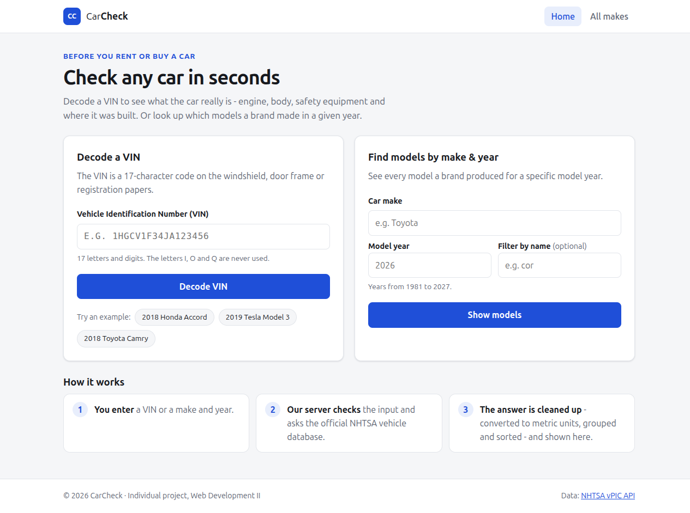
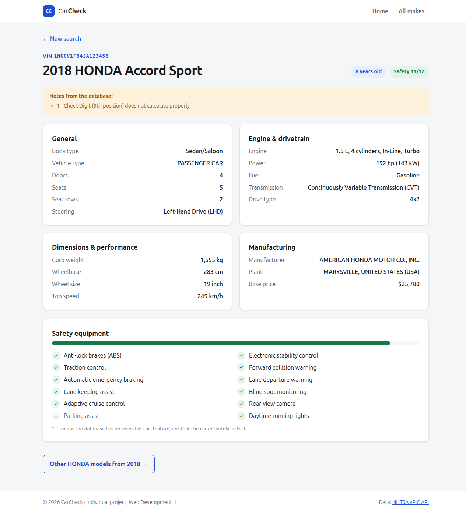
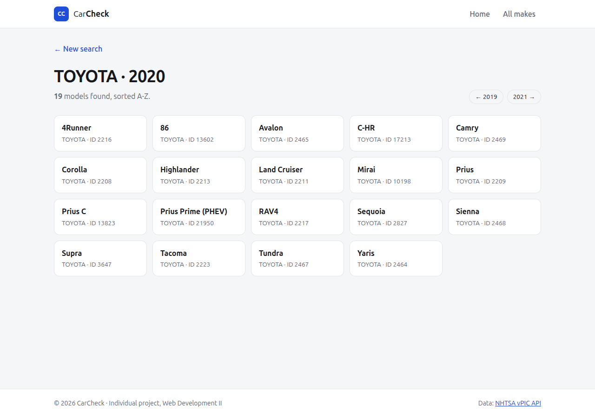

# CarCheck — VIN decoder & car model explorer

CarCheck is a small web application for anyone who is about to **rent or buy a car**.
You type a car's VIN (Vehicle Identification Number) and the app shows what the car really is:
body, engine, power, fuel, transmission, size, where it was built and which safety systems it has.
You can also see every model a brand produced in a given year, or browse all car makes A–Z.

Built with **Node.js, Express, Axios and EJS** for the Web Development II individual project.

## API used

**NHTSA vPIC API** (U.S. National Highway Traffic Safety Administration — Product Information Catalog)

- Documentation: <https://vpic.nhtsa.dot.gov/api/>
- Listed in [public-apis](https://github.com/public-apis/public-apis) → *Vehicle* → NHTSA
- Free, no registration and **no API key** required

| # | Endpoint | Used for |
|---|----------|----------|
| 1 | `GET /DecodeVinValues/{vin}?format=json` | Decode one VIN (details page) |
| 2 | `GET /GetModelsForMakeYear/make/{make}/modelyear/{year}?format=json` | Models of a make in one year |
| 3 | `GET /GetMakesForVehicleType/car?format=json` | All passenger-car makes |

## Features

- **VIN decoder**: validates the VIN (17 characters, no I/O/Q), decodes it and shows the result grouped into clear sections.
- **Data processing** (not raw JSON):
  - keeps ~30 useful fields out of ~150 returned, and hides empty values;
  - converts US units to metric: hp → kW, lb → kg, mph → km/h, inches → cm;
  - calculates the car's age from the model year;
  - counts the safety features (e.g. "Safety 11/12") and shows them as a progress bar;
  - shows the database's warnings (for example, a wrong check digit).
- **Model search** by make and year, with an optional name filter. The results are de-duplicated, filtered and sorted A–Z. Buttons switch to the previous or next year.
- **All makes** page: makes grouped by first letter, with jump links.
- **Validation** on the server, with friendly messages next to the form fields. The form keeps what the user typed.
- **Error handling**: timeouts, no internet, 4xx/5xx, rate limits (429) and "no results" all show a friendly page. Technical details go to the console only, and the server never crashes. A request that fails because of the network is retried once.
- **Responsive design** in plain CSS (works on phones and desktops).

## Routes

| Method | URL | What it does |
|--------|-----|--------------|
| GET | `/` | Home page with the two forms |
| POST | `/vin` | Receives the VIN form, validates it and redirects to `/vin/:vin` |
| GET | `/vin/:vin` | Details page for one vehicle (API request #1) |
| GET | `/models?make=&year=&filter=` | Result page: models of a make in a year (API request #2) |
| GET | `/makes` | All passenger-car makes A–Z (API request #3) |
| any | anything else | 404 page |

## Project structure (MVC)

```
├── app.js                       # entry point: settings, middleware, routes, error handlers
├── routes/vehicleRoutes.js      # URL -> validation middleware -> controller
├── controllers/vehicleController.js  # request handling, calls service + model, renders views
├── services/nhtsaService.js     # all Axios requests + translation of API errors
├── models/vehicleModel.js       # data processing: select, convert, calculate, filter, sort
├── middleware/
│   ├── logger.js                # custom request logger (method, URL, status, time)
│   ├── validators.js            # input validation before calling the API
│   └── errorHandlers.js         # 404 handler + central error handler (err, req, res, next)
├── views/
│   ├── partials/header.ejs, footer.ejs
│   ├── index.ejs, vin.ejs, models.ejs, makes.ejs, error.ejs
├── public/styles/main.css, public/images/favicon.svg
├── docs/screenshots/            # screenshots used in this README
├── .env.example
└── package.json
```

### Middleware used

- Built-in: `express.static`, `express.urlencoded`, `express.json`
- Custom: `requestLogger`, `validateVinForm`, `validateVinParam`, `validateModelSearch`, a small `res.locals` middleware (current year and path for the views)
- `notFound` (404) and `errorHandler` (centralized error-handling middleware)

## Installation and running

Requirements: Node.js 18 or newer.

```bash
git clone https://github.com/tartib-apps/individual-aitmagambetov.git
cd individual-aitmagambetov
npm install
cp .env.example .env      # on Windows: copy .env.example .env
npm start
```

Open <http://localhost:3000>.

`.env` settings (all have default values, so the app also starts without `.env`):

| Variable | Default | Meaning |
|----------|---------|---------|
| `PORT` | `3000` | Port of the Express server |
| `NHTSA_BASE_URL` | `https://vpic.nhtsa.dot.gov/api/vehicles` | Base URL of the API |
| `API_TIMEOUT_MS` | `8000` | Axios timeout in milliseconds |

Try these: VIN `5YJ3E1EA7KF317000` (Tesla Model 3), or make `Toyota` with year `2020`.

## Screenshots

**Home page**



**VIN details**



**Models of a make and year**



## Credits

- Vehicle data: [NHTSA vPIC API](https://vpic.nhtsa.dot.gov/api/)
- Project structure based on the course lectures (Express, Middleware, EJS partials, Axios)
- AI assistance is disclosed in [AI_DECLARATION.md](AI_DECLARATION.md)
